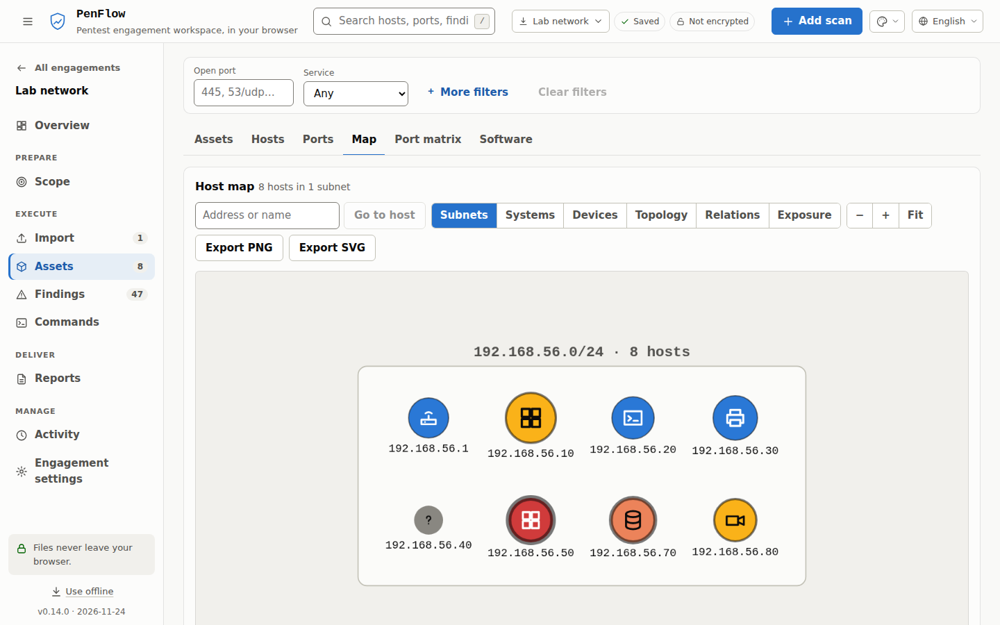
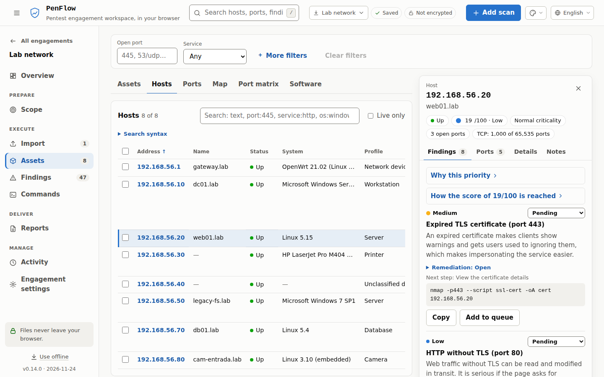

<div align="center">


# PenFlow

**One engagement, one workspace, one source of truth.**

A workspace for pentest engagements that runs entirely in your browser:<br />
bring together what your tools find and what you document, up to the report.<br />
No backend, no network requests: your data never leaves your browser.

[](https://github.com/apiraces-hiberuscom/penflow/releases/latest)
[](LICENSE)
[](#privacy)
[](#three-ways-to-use-it)
[](#what-it-does-today)

### [Open the live demo »](https://apiraces-hiberuscom.github.io/penflow/)

[Download the portable copy](https://github.com/apiraces-hiberuscom/penflow/releases/latest) ·
[Install it as an app](#install-it-as-an-app)

<br />

<picture>
  <source media="(prefers-color-scheme: dark)" srcset="docs/img/overview-dark.png" />
  
</picture>

</div>

<br />

> [!NOTE]
> **Early stage.** PenFlow starts from [vnmap](https://github.com/apiraces-hiberuscom/vnmap), by
> the same author. Today it covers vnmap's network analysis, organised around the engagement;
> the rest of engagement management is being built on top of it, release by release (see
> [Roadmap](#roadmap)).

## Why PenFlow

<table>
  <tr>
    <td width="33%" valign="top">
      <h3>🔒 Private by design</h3>
      No backend and no network requests. Engagement data is kept in your browser, and a strict
      Content Security Policy makes sure nothing is sent anywhere.
    </td>
    <td width="33%" valign="top">
      <h3>🧭 Human in the loop</h3>
      Tool output becomes candidates you review, never confirmed findings on its own. Inferences are
      shown as inferences, with where every piece of data came from.
    </td>
    <td width="33%" valign="top">
      <h3>📦 Works anywhere</h3>
      Online, installed as an app, or as a portable copy on a test machine inside the client's
      network with no internet. Nothing to install but a browser.
    </td>
  </tr>
</table>

## What it does today

<table>
  <tr>
    <td width="50%" valign="top">
      <picture>
        <source media="(prefers-color-scheme: dark)" srcset="docs/img/map-dark.png" />
        
      </picture>
      <p align="center"><b>Network map</b><br /><sub>By subnet, system, device, topology, relations or exposure. Colour is risk, size is open ports.</sub></p>
    </td>
    <td width="50%" valign="top">
      <picture>
        <source media="(prefers-color-scheme: dark)" srcset="docs/img/findings-dark.png" />
        
      </picture>
      <p align="center"><b>Findings</b><br /><sub>Built-in rules, each with why it matters, a review status and the next command.</sub></p>
    </td>
  </tr>
  <tr>
    <td width="50%" valign="top">
      <picture>
        <source media="(prefers-color-scheme: dark)" srcset="docs/img/host-dark.png" />
        
      </picture>
      <p align="center"><b>Every host in detail</b><br /><sub>Risk and why, findings, ports, services, scripts, tags, notes and remediation.</sub></p>
    </td>
    <td width="50%" valign="top">
      <picture>
        <source media="(prefers-color-scheme: dark)" srcset="docs/img/builder-dark.png" />
        
      </picture>
      <p align="center"><b>Command builder</b><br /><sub>Scenarios, an authorized scope and a reverse mode that explains any command you paste.</sub></p>
    </td>
  </tr>
</table>

- **Engagement summary** on Overview: client, status, dates and days to delivery, assets in and out
  of scope, candidates to triage, a list of what is pending before delivery with a link to each
  place, and the recent activity.
- **Organised by engagement.** The sidebar follows the work: Overview, then Execute (Import,
  Assets, Findings, Commands), Deliver (Reports) and Manage (Engagement settings). Save and
  encryption state are always visible in the header.
- **Imports** nmap (XML, grepable and normal) and masscan (XML, list and JSON) results, merged by
  IP address.
- **Asset inventory**: every host, domain, URL, application, API or cloud resource once, added by
  hand or by an import, with its scope status, services, pending detections, review and the tools
  that saw it. Merge assets that are the same and separate them again without losing anything.
  Each asset has a card with its services, candidates and the history of every import, and every
  observed value tells which import it comes from.
- **Explainable risk and priority** per host, coverage, anomalies, correlations and an inventory of
  products and versions (the Software tab).
- **Known vulnerabilities** from the `vulners` script or from a CVE base you import (NVD JSON 2.0).
  Nothing is looked up online.
- **Reports** in HTML (print-ready, with your cover and logo), Markdown, CSV and JSON. The scope
  note accepts Markdown, with a preview; whatever you write is always shown as text, never as HTML.
- **Engagements with their details**: client, type, status, dates, reference and team. Find them
  by name, reference or client, filter by status, type or client, and sort by activity, name or due
  date. Each new engagement asks you to confirm you are authorised to test it.
- **Structured scope** with inclusions and exclusions (an exclusion always wins), revisions you can
  compare, restrictions and time windows, and target lists for nmap `-iL` and `--excludefile`.
  Scope checks never resolve names. Hosts and services outside it are marked in every view and in
  reports, and the command builder always leaves the exclusions out.
- **Activity** of each engagement: what changed, who and when, filterable and linked to where it
  happened. It never keeps the scope, notes or imported content.
- **Clients**, with sector, notes and contacts: search them, archive them and see each client's
  engagements on its sheet. They are kept unencrypted in this browser, and the view says so; the
  client of an encrypted engagement is kept inside it.
- **Encryption per engagement** with a passphrase (AES-256-GCM, PBKDF2-SHA-256 with 600 000
  iterations), from its settings or when it is created. Only the alias you choose is shown while
  it is locked, and there is no recovery if the passphrase is forgotten.
- **Your profile and preferences**, kept in this browser: display name, interface and report
  language, theme and evidence size limit, in **Settings**.
- **Five languages** (English, Español, Deutsch, Français, Русский), light, dark and high contrast
  themes, and keyboard and screen reader support.

## Roadmap

Planned for the next releases, all in the browser and without network:

- Out-of-scope warnings in the import preview.
- Findings with CVSS 3.1/4.0, a bundled CWE catalogue and finding templates.
- Evidence (screenshots and files) with hashes, safe preview and redaction.
- Methodologies and checklists.
- Importers for Nuclei, Burp Suite, OWASP ZAP, Nessus, OpenVAS and generic CSV, with preview and
  triage of candidates.
- Executive and technical reports, an automatic lock after inactivity, and engagement packages
  (optionally encrypted) to merge work between auditors.

## Three ways to use it

| Way                                                                  | Best for                                                    | Needs                                    |
| -------------------------------------------------------------------- | ----------------------------------------------------------- | ---------------------------------------- |
| 🌐 **[Online demo](https://apiraces-hiberuscom.github.io/penflow/)** | Trying it, with test data only                              | A browser                                |
| 💻 **[Installed app](#install-it-as-an-app)**                        | Opening it like any other app, also offline                 | Chrome or Edge                           |
| 📦 **[Portable copy](#portable-copy)**                               | A computer with no internet, such as a test machine on site | A browser (and `python3` on Linux/macOS) |

> [!WARNING]
> The online demo shares its web address with other demos of the same GitHub account. Use it with
> test data only; for real engagements, use the portable copy or the app installed from it.

<div align="center">
  <picture>
    <source media="(prefers-color-scheme: dark)" srcset="docs/img/offline-dark.png" />
    
  </picture>
  <p><sub>Everything is one click away from <b>Use offline</b>, in the sidebar footer.</sub></p>
</div>

### Install it as an app

In Chrome or Edge, open a running portable copy (or the
[demo](https://apiraces-hiberuscom.github.io/penflow/)) and choose **Use offline › Install**, or
the install icon in the address bar. The app opens in its own window and works without a
connection. When a new version is available, it tells you, and updates only when you accept, after
saving your work.

> [!NOTE]
> Firefox on the desktop cannot install web apps: use the portable copy. In Safari on macOS, use
> **File › Add to Dock**.

### Portable copy

Download `penflow-<version>-portable.zip` and `SHA256SUMS` from the
[latest release](https://github.com/apiraces-hiberuscom/penflow/releases/latest).

<details open>
<summary><b>Windows</b></summary>
<br />

1. **Unblock the ZIP**, since it came from the internet: right-click it › **Properties** › tick
   **Unblock** › **OK**. Or, in PowerShell:
   ```powershell
   Unblock-File .\penflow-*-portable.zip
   ```
2. Extract it and open the `penflow-<version>` folder.
3. Double-click **`penflow.cmd`**.

It uses the PowerShell that comes with Windows, needs no administrator rights and does not change
the system execution policy: it only bypasses it for that one process.

</details>

<details open>
<summary><b>Linux and macOS</b></summary>
<br />

```bash
unzip penflow-*-portable.zip
./penflow-*/penflow.sh
```

It needs `python3`, which most systems have. Without it, the launcher explains how to serve the
`app/` folder with any static web server.

</details>

<details>
<summary><b>What the launcher does</b></summary>
<br />

- Serves the `app/` folder at <http://127.0.0.1:47821/>, on that computer only: it is not
  reachable from the network.
- Opens your default browser there, and stops with `Ctrl+C` or by closing its window.
- Answers only `GET` and `HEAD` for files inside `app/`: no directory listing, nothing outside.
- Downloads nothing, writes nothing outside its folder and needs no administrator rights.

If port 47821 is in use, it stops and says so. `--port <n>` chooses another one, but each address
has its own data store (see below), so keep using the same port.

</details>

### Verify the download

Compare the SHA-256 of the ZIP with the one in `SHA256SUMS`:

```powershell
# Windows (PowerShell): the hash must match the one in SHA256SUMS
Get-FileHash .\penflow-*-portable.zip -Algorithm SHA256
```

```bash
sha256sum -c SHA256SUMS         # Linux
shasum -a 256 -c SHA256SUMS     # macOS
```

### Moving work between copies

Data is saved in the browser, and browsers keep it separately for each address. The demo and the
portable copy (and the portable copy on another port) do not see each other's data. To move a
project, open **Engagement settings › Portability** and use **Export project** in one copy and
**Import project** in the other. Project files exported from vnmap can be imported too.

## Privacy

- **No network requests.** Everything is parsed and stored in your browser. A strict Content
  Security Policy (`connect-src 'none'`) enforces it: the page cannot send your data anywhere.
- **Imported content is always shown as text**, never interpreted as HTML: banners, script output
  and tool reports are written by the systems under test.
- **It never runs tools or commands.** It only writes commands for you to copy and reads the files
  you give it.
- **Transparent build.** This repository publishes the application exactly as it runs: the
  JavaScript in the [`gh-pages`](https://github.com/apiraces-hiberuscom/penflow/tree/gh-pages)
  branch and in each release is minified, not obfuscated. The source code is kept in a separate
  repository.

## Responsible use

> [!IMPORTANT]
> Test only systems you own or are explicitly authorized to assess. Scanning or attacking systems
> without permission can be illegal.

PenFlow is an independent project. It is not affiliated with or endorsed by the Nmap Project or by
the makers of any other tool it reads.

## Problems and suggestions

Open an [issue](https://github.com/apiraces-hiberuscom/penflow/issues). Please do not attach real
engagement data or tool output: it describes someone's systems.

---

<div align="center">
<sub>Created by <b>Alejandro Piraces Perez</b> · Released under the <a href="LICENSE">MIT License</a></sub>
</div>
