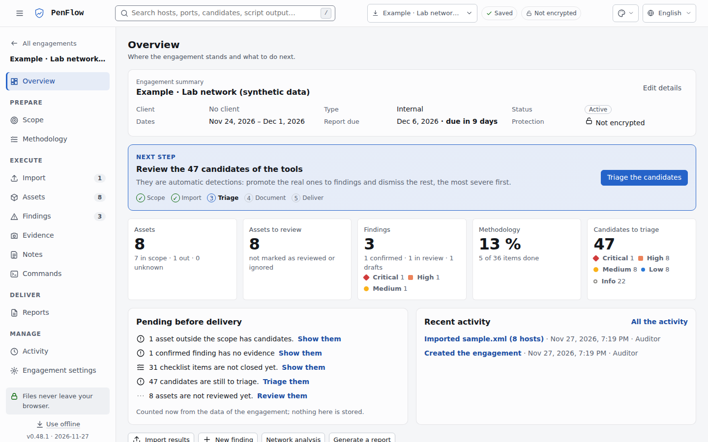
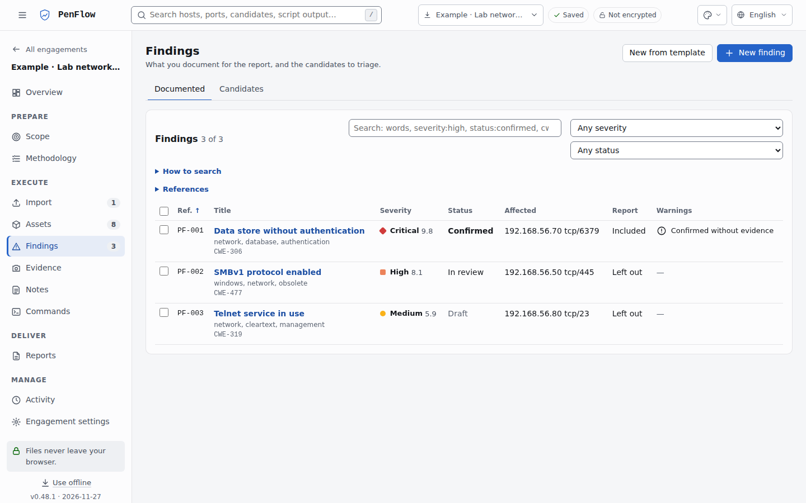
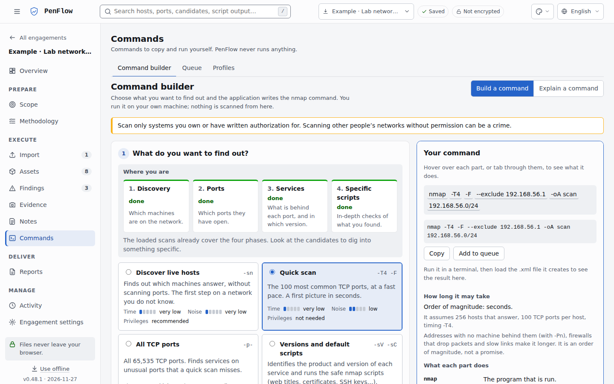
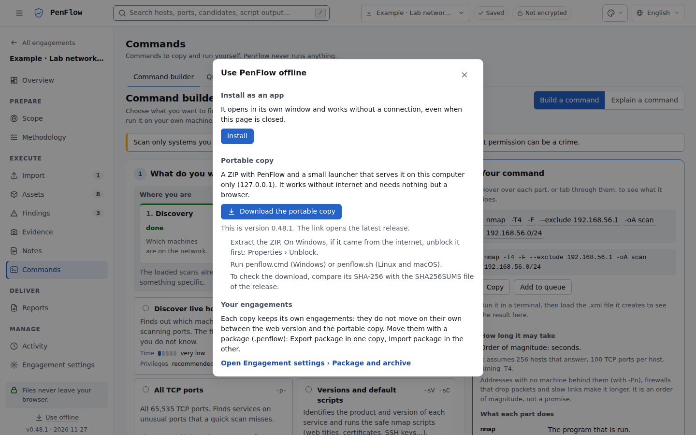

<div align="center">


# PenFlow

**One engagement, one workspace, one source of truth.**

A workspace for pentest engagements that runs entirely in your browser:<br />
bring together what your tools find and what you document, up to the report.<br />
No backend, no network requests: your data never leaves your browser.

[](https://github.com/apiraces-hiberuscom/penflow/releases/latest)
[](LICENSE)
[](#privacy)
[](#three-ways-to-use-it)
[](#what-it-does-today)

### [Open the live demo »](https://apiraces-hiberuscom.github.io/penflow/)

[Download the portable copy](https://github.com/apiraces-hiberuscom/penflow/releases/latest) ·
[Install it as an app](#install-it-as-an-app)

<br />

<picture>
  <source media="(prefers-color-scheme: dark)" srcset="docs/img/overview-dark.png" />
  
</picture>

</div>

<br />

> [!NOTE]
> **Early stage.** PenFlow starts from [vnmap](https://github.com/apiraces-hiberuscom/vnmap), by
> the same author. Today it covers vnmap's network analysis, organised around the engagement;
> the rest of engagement management is being built on top of it, release by release (see
> [Roadmap](#roadmap)).

## Why PenFlow

<table>
  <tr>
    <td width="33%" valign="top">
      <h3>🔒 Private by design</h3>
      No backend and no network requests. Engagement data is kept in your browser, and a strict
      Content Security Policy makes sure nothing is sent anywhere.
    </td>
    <td width="33%" valign="top">
      <h3>🧭 Human in the loop</h3>
      Tool output becomes candidates you review, never confirmed findings on its own. Inferences are
      shown as inferences, with where every piece of data came from.
    </td>
    <td width="33%" valign="top">
      <h3>📦 Works anywhere</h3>
      Online, installed as an app, or as a portable copy on a test machine inside the client's
      network with no internet. Nothing to install but a browser.
    </td>
  </tr>
</table>

## What it does today

<table>
  <tr>
    <td width="50%" valign="top">
      <picture>
        <source media="(prefers-color-scheme: dark)" srcset="docs/img/map-dark.png" />
        
      </picture>
      <p align="center"><b>Network map</b><br /><sub>By subnet, system, device, topology, relations or exposure. Colour is risk, size is open ports.</sub></p>
    </td>
    <td width="50%" valign="top">
      <picture>
        <source media="(prefers-color-scheme: dark)" srcset="docs/img/findings-dark.png" />
        
      </picture>
      <p align="center"><b>Findings</b><br /><sub>Built-in rules, each with why it matters, a triage status and the next command.</sub></p>
    </td>
  </tr>
  <tr>
    <td width="50%" valign="top">
      <picture>
        <source media="(prefers-color-scheme: dark)" srcset="docs/img/host-dark.png" />
        
      </picture>
      <p align="center"><b>Every host in detail</b><br /><sub>Risk and why, findings, ports, services, scripts, tags, notes and remediation.</sub></p>
    </td>
    <td width="50%" valign="top">
      <picture>
        <source media="(prefers-color-scheme: dark)" srcset="docs/img/builder-dark.png" />
        
      </picture>
      <p align="center"><b>Command builder</b><br /><sub>Scenarios, an authorized scope and a reverse mode that explains any command you paste.</sub></p>
    </td>
  </tr>
</table>

- **Engagement summary** on Overview: client, status, dates and days to delivery, assets in and out
  of scope, findings and candidates to triage, methodology progress, a list of what is pending
  before delivery (checklist items still open among them) with a link to each place, the
  recent activity and a way to the network analysis.
- **Findings you document**, apart from what tools detect: a card in sections (affected assets,
  services and locations, description, impact, reproduction and remediation in safe Markdown),
  stable references such as `PF-001`, a CVSS 3.1 and 4.0 calculator whose score sets the
  severity, the CWE catalogue of MITRE bundled for offline search, a library of finding
  templates (97 built in, in English, Spanish, German, French and Russian, offered in the
  language of your reports, plus your own), statuses from draft to confirmed, search, filters and bulk
  actions, and warnings before delivery (no evidence, no remediation, out of scope, possible
  duplicate). Create a retest that carries the confirmed findings to a new engagement, then give
  each one its result (remediated, partially remediated, not remediated, risk accepted) with a
  date, a note and evidence of the retest, compare it with the original side by side and deliver
  the retest section of the report. A later scan that still sees a finding marked remediated is
  pointed out; the status never changes on its own.
- **Next step, always in sight**: the Overview proposes the one thing to do next (define the scope,
  import, triage, add evidence, document, deliver) and shows the stage of the engagement. Press
  `?` for the keyboard shortcuts: `g c` goes to the candidates, `j`/`k`/`x` pick them, `p`
  promotes and `d` dismisses, `Ctrl+S` saves a finding.
- **Triage of candidates**: what the rules detect waits in Findings › Candidates, grouped by rule or
  by asset. Tick groups or single candidates and, all at once, promote them to one new finding
  (written in a side panel, without leaving the list), add
  them to a finding you already have, dismiss them with a reason (false positive, duplicate, out of
  scope, not relevant) or put them back to new; the last change can be undone. A candidate keeps
  its decision when the scan is loaded again, says when the last scan of that place no longer
  reports it and in how many scans it was seen, and nothing is ever confirmed on its own. False
  positives and duplicates leave the risk score of their host.
- **Evidence** with its SHA-256: drop, choose or paste screenshots, logs, HTTP exchanges and files,
  link them to findings and assets, mark the relevant lines of a text, and check their integrity.
  The type is told by the content; only checked images are shown, and SVG, HTML and PDF never
  render. Files are kept once per content, encrypted with the engagement. Image metadata (EXIF,
  location, device) is removed when an image is added, and a screenshot can be **redacted**:
  opaque boxes and a crop make a new PNG copy, the original is kept, and the report uses the
  redacted one.
- **Methodologies and checklists**: six built-in methodologies in English and Spanish (generic
  phases based on NIST SP 800-115, external network, internal network and Active Directory, web
  application, API and mobile), with OWASP WSTG, ASVS, API Security Top 10 and MASVS identifiers
  as references. Follow them as a checklist by phases with its progress, take notes, mark what
  does not apply, add items of your own, and create findings or add evidence from any item.
  Updating to a new version of a methodology keeps the work done.
- **Notes** of the engagement: meeting notes, test accounts given by the client and observations
  that are not findings, in safe Markdown with a title and tags, linked to findings and assets and
  listed in their cards. A note can be marked as holding credentials only in an encrypted
  engagement, and such notes stay out of packages without a passphrase. Notes never go to a report.
- **Organised by engagement.** The sidebar follows the work: Overview, then Prepare (Scope,
  Methodology), Execute (Import, Assets, Findings, Evidence, Notes, Commands), Deliver (Reports) and Manage (Engagement settings). Save and
  encryption state are always visible in the header.
- **Import centre** for nmap (XML, grepable and normal), masscan (XML, list and JSON), Nuclei
  (JSON lines, `-jsonl`), Burp Suite (issues XML), OWASP ZAP (traditional XML or JSON), Nessus
  (`.nessus` v2) and OpenVAS / Greenbone (XML report) results, and any other CSV:
  drop the files, choose them or paste the output and see what was understood before anything is
  added. It counts the new and existing assets, services and hosts outside the scope, warns about a
  file already imported, and keeps the history of each import, with its hash and original copy,
  which you can undo. Results are merged by IP address; each host keeps its names, operating
  system, MAC address and network card maker. Files of up to 500 MB.
- **Nuclei detections are candidates**, never findings: each result lands in the triage with the
  template, the severity Nuclei gave (and the suggested one), where it matched, its references,
  CVE, CWE and CVSS, what it extracted and the curl command as text to copy (never run).
  Informative ones are folded. HTTP requests and responses are kept only if you ask for them at
  import, and become evidence when you document the detection as a finding. Reimporting keeps
  every decision; results that only name a host are kept on a host by that name.
- **Burp Suite issues** (Report issues, XML) land in the same triage: the confidence Burp gave
  (Certain, Firm, Tentative) is shown on each candidate, the HTML of its descriptions becomes plain
  text, and the base64 requests and responses are decoded only if you ask for them at import. One
  issue type on two parameters is two candidates; a later export of the same engagement keeps every
  decision.
- **OWASP ZAP alerts** (traditional XML or JSON, "plus" variants included) land in the same
  triage, one candidate per alert and site with its places listed, or one per place if you choose
  so in the preview. ZAP writes no IP addresses: a site is a host named by its name, and joins the
  asset of its address once nmap sees that name.
- **Nessus results** (`.nessus` v2) land in the same triage, one candidate per plugin, host, port
  and protocol, with the severity, CVE, CWE, CVSS and plugin output Nessus gave. Informative
  plugins are kept as data of each asset unless you ask for them as candidates, and the scan
  policy, which may hold credentials, is never read.
- **OpenVAS / Greenbone results** (the XML report of GVM, from OpenVAS 8 on) land in the same
  triage, one candidate per NVT, host, port and protocol, with the threat, CVE, CVSS and what the
  NVT saw. The quality of detection (QoD) is shown as confidence, and results under 70 % are
  hidden until you ask for them, as in Greenbone. Log results are kept as data of each asset.
- **Any CSV** (a tool without its own importer, or an inventory from the client): map its columns
  to asset, port, title, severity, CVE, CVSS and more, from suggestions, and choose what each
  severity value means; nothing ambiguous is guessed. Rows with a title become candidates, the rest
  assets and services. Save the mapping as a profile and the next file of that tool is mapped for
  you.
- **Asset inventory**: every host, domain, URL, application, API or cloud resource once, added by
  hand or by an import, with its scope status, services, pending detections, review and the tools
  that saw it. Merge assets that are the same and separate them again without losing anything.
  Each asset has a card with its services, findings, evidence, candidates and the history of every
  import,
  and every observed value tells which import it comes from.
- **Network analysis** under Assets › Network: summary, hosts, ports, map, port matrix, software
  and scan comparison. Explainable risk and priority per host (an aid to prioritise, not a
  replacement for the severity of findings), coverage, anomalies, correlations and an inventory of
  products and versions. A host opens its asset card from any of them.
- **Known vulnerabilities** from the `vulners` script or from a CVE base you import (NVD JSON 2.0).
  Nothing is looked up online.
- **The report of the engagement**, made from what you documented: cover, document control,
  executive summary, scope, methodology coverage, findings with their evidence, retest and
  appendices, in the language you choose. One self-contained HTML file (no script, images
  embedded), a print layout to save it as PDF, and Markdown with its images in a ZIP. Each report
  is recorded in the activity with its SHA-256.
- **Engagement packages** (`.penflow`): the whole engagement, its evidence files and its
  activity in one file, optionally encrypted with its own passphrase and checked hash by hash when
  imported. To back up, to move work between copies of PenFlow, or to merge the work of several
  auditors: changes on one side are joined, changes on both sides are asked record by record.
- **Report templates**: full technical, executive and retest built in, and your own in the Library
  with your sections and order, logo, accent colour, introduction and notices. Export and import
  them as JSON.
- **Network report and data exports** in HTML, Markdown, CSV and JSON, below the report of the
  engagement. Whatever you write is always shown as text, never as HTML.
- **Home**, the panel of every engagement: the active ones with their methodology progress and
  next date, the open critical and high findings of all of them and the recent activity, each
  leading back to where it lives. A locked encrypted engagement shows only its alias. The first
  visit opens on a welcome with **Create engagement** and **Try with sample data**, an engagement of
  synthetic data only.
- **Engagements with their details**: client, type, status, dates, reference and team. Find them
  by name, reference or client, filter by status, type or client, and sort by activity, name or due
  date. Each new engagement asks you to confirm you are authorised to test it.
- **Structured scope** with inclusions and exclusions (an exclusion always wins), revisions you can
  compare, restrictions and time windows, and target lists for nmap `-iL` and `--excludefile`.
  Scope checks never resolve names. Hosts and services outside it are marked in every view and in
  reports, and the command builder always leaves the exclusions out.
- **Activity** of each engagement: what changed, who and when, filterable and linked to where it
  happened. It never keeps the scope, notes or imported content.
- **Clients**, with sector, notes and contacts: search them, archive them and see each client's
  engagements on its sheet. They are kept unencrypted in this browser, and the view says so; the
  client of an encrypted engagement is kept inside it.
- **Encryption per engagement** with a passphrase (AES-256-GCM, PBKDF2-SHA-256 with 600 000
  iterations), from its settings or when it is created. Only the alias you choose is shown while
  it is locked, and there is no recovery if the passphrase is forgotten.
- **Your profile and preferences**, kept in this browser: display name, interface and report
  language, theme, evidence size limit and image metadata removal, in **Settings**.
- **Five languages** (English, Español, Deutsch, Français, Русский), light, dark and high contrast
  themes, and keyboard and screen reader support.

## Roadmap

Planned for the next releases, all in the browser and without network:

- Redaction of screenshots and removal of image metadata.
- Your own methodologies in the Library, and the coverage of the checklist in the reports.
- An automatic lock after inactivity.

## Three ways to use it

| Way                                                                  | Best for                                                    | Needs                                    |
| -------------------------------------------------------------------- | ----------------------------------------------------------- | ---------------------------------------- |
| 🌐 **[Online demo](https://apiraces-hiberuscom.github.io/penflow/)** | Trying it, with test data only                              | A browser                                |
| 💻 **[Installed app](#install-it-as-an-app)**                        | Opening it like any other app, also offline                 | Chrome or Edge                           |
| 📦 **[Portable copy](#portable-copy)**                               | A computer with no internet, such as a test machine on site | A browser (and `python3` on Linux/macOS) |

> [!WARNING]
> The online demo shares its web address with other demos of the same GitHub account. Use it with
> test data only; for real engagements, use the portable copy or the app installed from it.

<div align="center">
  <picture>
    <source media="(prefers-color-scheme: dark)" srcset="docs/img/offline-dark.png" />
    
  </picture>
  <p><sub>Everything is one click away from <b>Use offline</b>, in the sidebar footer.</sub></p>
</div>

### Install it as an app

In Chrome or Edge, open a running portable copy (or the
[demo](https://apiraces-hiberuscom.github.io/penflow/)) and choose **Use offline › Install**, or
the install icon in the address bar. The app opens in its own window and works without a
connection. When a new version is available, it tells you, and updates only when you accept, after
saving your work.

> [!NOTE]
> Firefox on the desktop cannot install web apps: use the portable copy. In Safari on macOS, use
> **File › Add to Dock**.

### Portable copy

Download `penflow-<version>-portable.zip` and `SHA256SUMS` from the
[latest release](https://github.com/apiraces-hiberuscom/penflow/releases/latest).

<details open>
<summary><b>Windows</b></summary>
<br />

1. **Unblock the ZIP**, since it came from the internet: right-click it › **Properties** › tick
   **Unblock** › **OK**. Or, in PowerShell:
   ```powershell
   Unblock-File .\penflow-*-portable.zip
   ```
2. Extract it and open the `penflow-<version>` folder.
3. Double-click **`penflow.cmd`**.

It uses the PowerShell that comes with Windows, needs no administrator rights and does not change
the system execution policy: it only bypasses it for that one process.

</details>

<details open>
<summary><b>Linux and macOS</b></summary>
<br />

```bash
unzip penflow-*-portable.zip
./penflow-*/penflow.sh
```

It needs `python3`, which most systems have. Without it, the launcher explains how to serve the
`app/` folder with any static web server.

</details>

<details>
<summary><b>What the launcher does</b></summary>
<br />

- Serves the `app/` folder at <http://127.0.0.1:47821/>, on that computer only: it is not
  reachable from the network.
- Opens your default browser there, and stops with `Ctrl+C` or by closing its window.
- Answers only `GET` and `HEAD` for files inside `app/`: no directory listing, nothing outside.
- Downloads nothing, writes nothing outside its folder and needs no administrator rights.

If port 47821 is in use, it stops and says so. `--port <n>` chooses another one, but each address
has its own data store (see below), so keep using the same port.

</details>

### Verify the download

Compare the SHA-256 of the ZIP with the one in `SHA256SUMS`:

```powershell
# Windows (PowerShell): the hash must match the one in SHA256SUMS
Get-FileHash .\penflow-*-portable.zip -Algorithm SHA256
```

```bash
sha256sum -c SHA256SUMS         # Linux
shasum -a 256 -c SHA256SUMS     # macOS
```

### Moving work between copies

Data is saved in the browser, and browsers keep it separately for each address. The demo and the
portable copy (and the portable copy on another port) do not see each other's data. To move an
engagement, open **Engagement settings › Package and archive** and use **Export package** in one
copy and **Import a package** in the other (a package dropped in Import is recognised too). JSON
files of earlier versions, and those exported from vnmap, can be imported too.

## Privacy

- **No network requests.** Everything is parsed and stored in your browser. A strict Content
  Security Policy (`connect-src 'none'`) enforces it: the page cannot send your data anywhere.
- **Imported content is always shown as text**, never interpreted as HTML: banners, script output
  and tool reports are written by the systems under test.
- **It never runs tools or commands.** It only writes commands for you to copy and reads the files
  you give it.
- **Transparent build.** This repository publishes the application exactly as it runs: the
  JavaScript in the [`gh-pages`](https://github.com/apiraces-hiberuscom/penflow/tree/gh-pages)
  branch and in each release is minified, not obfuscated. The source code is kept in a separate
  repository.

## Responsible use

> [!IMPORTANT]
> Test only systems you own or are explicitly authorized to assess. Scanning or attacking systems
> without permission can be illegal.

PenFlow is an independent project. It is not affiliated with or endorsed by the Nmap Project or by
the makers of any other tool it reads.

## Problems and suggestions

Open an [issue](https://github.com/apiraces-hiberuscom/penflow/issues). Please do not attach real
engagement data or tool output: it describes someone's systems.

---

<div align="center">
<sub>Created by <b>Alejandro Piraces Perez</b> · Released under the <a href="LICENSE">MIT License</a></sub>
</div>
